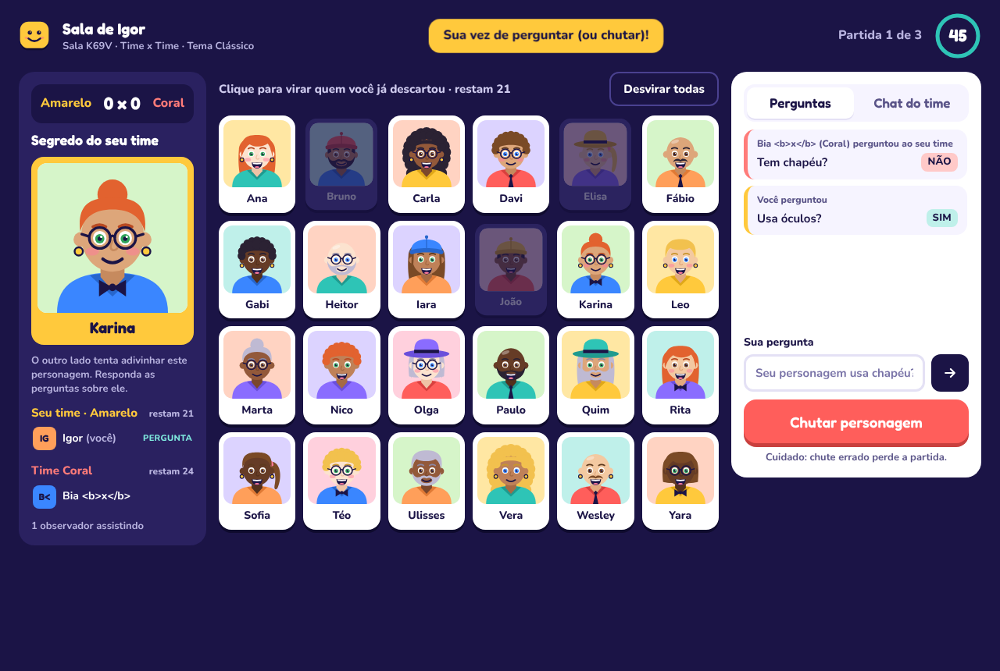
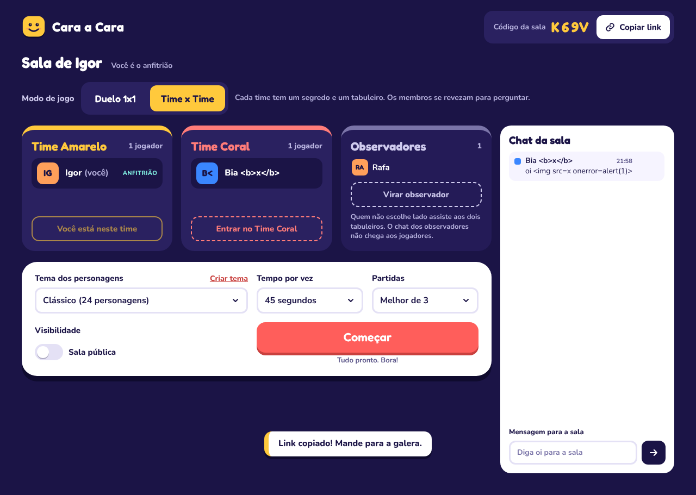
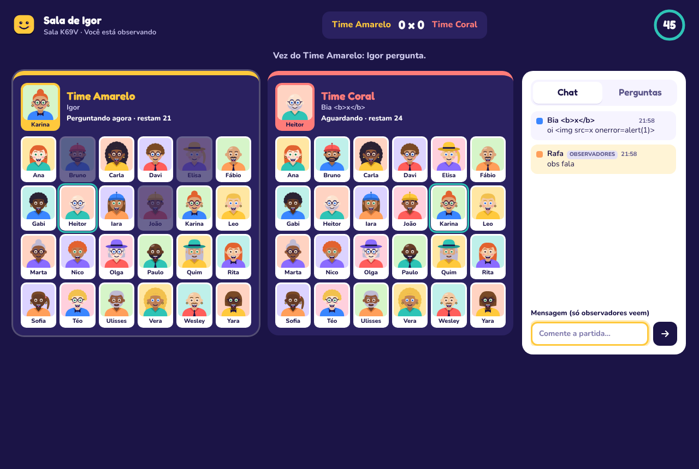

# Cara a Cara

**An open-source, real-time multiplayer guessing game for the browser.** Ask yes/no questions, flip down
the faces you have ruled out and be the first to guess your opponent's secret character.

Inspired by the classic "Guess Who?" board game, with Gartic-style online rooms: create a room, share
the link and play 1-vs-1 duels or team-vs-team matches while everyone else watches. All artwork and
characters are original. The game UI is in Brazilian Portuguese.



## Features

- **Online rooms**: create a room and share its link or 4-letter code, or join a public room from the home page.
- **Two game modes**
  - **1v1 duel**: two players at the table. The winner stays and the next person in the queue plays the loser's seat.
  - **Team vs team**: any number of players per side. Teammates share one board and take turns asking and answering, in a best-of-1/3/5 series.
- **Spectators**: anyone not on a side watches both boards and both secrets live. Their chat is separate, so they can't spoil the game.
- **Character themes**: a built-in "Clássico" set of 24 original illustrated characters, plus custom themes. Upload 12–24 pictures, name them, and share the theme publicly or by link.
- **Real time** over WebSockets, with turn timers, reconnection and walkover when a side disconnects.
- **Mostly Python**: FastAPI backend, server-rendered Jinja2 templates and dependency-free vanilla JS (no build step).

| Lobby | Spectator view |
|---|---|
|  |  |

## Quick start (Docker)

Requirements: Docker with Docker Compose.

```bash
git clone https://github.com/Igorcfig/guesswho.git
cd guesswho
cp .env.example .env      # set your own database password
docker compose up --build
```

Open http://localhost:8000. Compose starts two services:

| Service | What it is |
|---|---|
| `app` | FastAPI + Uvicorn (single worker, because room state lives in memory). Uploaded theme images are stored in the `uploads` volume. |
| `db` | PostgreSQL 16 (volume `pgdata`), storing custom themes. It is not exposed on the host. |

Database tables are created automatically on startup.

### Configuration

All settings come from environment variables, which Compose reads from a `.env` file. `.env` and
`.env.*` are git-ignored; only `.env.example` is committed.

| Variable | Default | Description |
|---|---|---|
| `APP_PORT` | `8000` | Host port for the web app |
| `POSTGRES_USER` | (required) | Database user |
| `POSTGRES_PASSWORD` | (required) | Database password. Special characters are fine; wrap the value in single quotes if it contains `#` or `$` |
| `POSTGRES_DB` | (required) | Database name |
| `REPO_URL` | this repository | Source-code link shown on the home page (handy for forks) |

For production, keep a separate file and pass it explicitly:

```bash
cp .env.example .env.prod   # e.g. generate a password with: openssl rand -base64 24
docker compose --env-file .env.prod up -d --build
```

> Postgres applies the password only when the `pgdata` volume is first created. If you change it later,
> update it inside the database or recreate the volume with `docker compose down -v` (this deletes saved themes).

## Local development (without Docker)

```bash
python -m venv .venv
.venv/bin/pip install -r requirements-dev.txt
.venv/bin/uvicorn app.main:app --reload
```

Without database variables the app uses SQLite (`./dev.db`) and stores uploads in `./uploads`.
You can also set `DATABASE_URL` directly, or `POSTGRES_USER`/`POSTGRES_PASSWORD`/`POSTGRES_HOST`/`POSTGRES_PORT`/`POSTGRES_DB`.

### Running the tests

```bash
.venv/bin/python -m pytest
```

The suite covers the game rules, the HTTP API and full matches over WebSocket. It runs on SQLite and does not need Postgres.

## How to play

1. Each side (A and B) is dealt a secret character; your goal is to find out the other side's secret.
2. On your turn, ask a yes/no question (the other side answers) **or** make a guess.
3. Flip down the characters you've ruled out. In team mode the board is shared by the team.
4. A correct guess wins the match; a wrong guess loses it.
5. Each phase is timed (30/45/60/90 s). If time runs out, the turn passes to the other side.
6. If a side has nobody connected for 60 s during a match, the other side wins by walkover.

Custom themes can be created at `/temas/novo` (12–24 characters, PNG/JPEG/WEBP images up to 2 MB each).

## Project structure

```
app/
  main.py          FastAPI app, page routes, static and upload mounts
  config.py        settings from environment variables
  api/             REST endpoints (rooms, themes)
  game/rules.py    pure game logic (turns, timers, scoring, per-player snapshots)
  realtime/        WebSocket handling, room manager, timers
  templates/       Jinja2 pages
  static/          CSS, vanilla JS modules, character SVGs
tests/             pytest suite
tools/             character generator script
docs/SPEC.md       technical spec: HTTP API and WebSocket protocol
docs/mock/         original design mocks
```

The full WebSocket protocol and game rules are documented in [docs/SPEC.md](docs/SPEC.md) (in Portuguese).

## Contributing

Contributions are welcome! To contribute:

1. Open an issue to discuss a bug or an idea.
2. Fork the repository and create a branch.
3. Make your change with tests where it makes sense, and make sure `pytest` passes.
4. Open a pull request describing what changed and why.

The classic characters are generated by `tools/gen_characters.py`; edit the script rather than the SVG files.

## License

Released under the [MIT License](LICENSE).
